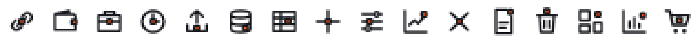

# Phân tích bộ icon Notch cho QLBanHang

> Brainstorm: 2026-10-14 21:15:55 · Phát hiện và số đo: [section-01-findings.md](section-01-findings.md) · Góp ý cho tác giả bộ icon: [section-02-author-feedback.md](section-02-author-feedback.md) · Mockup phương án D: [mockup-01-home.html](mockup-01-home.html), [mockup-02-stock-out.html](mockup-02-stock-out.html)

## Problem framing

Một nhà thiết kế bên ngoài chia sẻ canvas **"Notch — Bộ icon phần mềm quản lý"** (artifact `SFZ2xWdgDPKVgeHLiT65uQ`, bản 1791966097-e8e5, đọc ngày 2026-10-14). Canvas có 5 artboard:
- style guide;
- thư viện 40 icon;
- ví dụ dùng trong giao diện;
- hai màn đề xuất cho QLBanHang: Tổng quan và Thêm phiếu nhập kho.

Đặc điểm của bộ Notch:
- **Nét:** lưới 24, nét 1,75, đầu nét bo tròn, khung chữ nhật góc vuông.
- **Khối notch:** mỗi icon có đúng một khối đặc 4×4 (bo 1) đặt vào phần mang nghĩa.
- **Màu:** Ink `#15171C` cho nét, Signal `#FF5A1F` cho khối, Paper `#F3F2EE` cho nền, Mute `#9A9EA6`.
- **Trạng thái** thể hiện qua màu khối: xám là mặc định, Ink khi hover, Signal khi đang chọn, khối rỗng khi vô hiệu, đỏ khi cảnh báo.

QLBanHang hiện dùng `lucide-react` 0.453:
- 97 icon, 77 file, khoảng 290 lượt dùng, import trực tiếp ở từng file.
- Icon được tô màu theo hành động bằng class Tailwind thô. Code hiện tại khớp phương án 1 trong mockup 260519, dù brainstorm đó không ghi lựa chọn nào.
- Sidebar dùng ô màu theo nhóm với icon trắng (style C, 261012).
- Một số chỗ còn dùng ký tự ✕ ▾ ▲▼ ← → thay cho icon.

Câu hỏi: có nên áp dụng Notch không, áp dụng theo cách nào, tốn bao nhiêu công sức.

## Goals

- Báo cáo giúp team quyết định. Gồm 4 phần: độ phủ icon, xung đột với quy ước hiện tại, kiểm tra kỹ thuật bộ icon, phương án và công sức.
- Một phụ lục góp ý riêng gửi tác giả bộ icon.
- Mockup trang chủ và form Phiếu xuất kho theo phương án được khuyến nghị.

## Non-goals

- Triển khai bất cứ thứ gì trong lần brainstorm này.
- Áp dụng phần ngôn ngữ thị giác khác của canvas: nền Paper, font Be Vietnam Pro, sidebar tối, thanh tab màn hình đang mở, bố cục mới của Tổng quan và form nhập kho. Nếu cần thì brainstorm riêng.
- Vẽ icon mới. Đây là việc của tác giả bộ icon.

## Quyết định đã chốt

| Câu hỏi | Quyết định |
|---|---|
| Phạm vi | Chỉ phân tích, chưa áp dụng |
| Người đọc | Team, để quyết định; tác giả bộ icon, qua phụ lục [section-02](section-02-author-feedback.md) |
| Nội dung | Độ phủ, xung đột quy ước, kiểm tra kỹ thuật, phương án và công sức |
| Khuyến nghị | **Phương án D:** làm registry trước, quyết định Notch sau |
| Icon ở nhãn KPI trang chủ | Giữ, thêm vào ở bước 1 |
| Mockup | Trang chủ và form Phiếu xuất kho, mỗi mockup có 3 chế độ: Hiện tại, Bước 1, Bước 2 |

## Constraints & assumptions

- **Đo hình học:** dùng Edge headless ở độ phân giải 1x.
  - Lấy mẫu đường tâm của path bằng `getPointAtLength`, bước 0,005 đơn vị lưới.
  - Khe = khoảng cách nhỏ nhất từ đường tâm tới khối (hình chữ nhật bo góc) trừ đi nửa độ dày nét.
  - Độ dày nét theo bảng của canvas: 16px nét 2 · 20px nét 1,85 · 24px nét 1,75 · 32px nét 1,6.
- **Màu:** tương phản tính theo độ sáng tương đối của WCAG. Mù màu mô phỏng bằng ma trận Machado 2009, mức 1,0.
- **Lượt dùng icon:** đếm `<Icon` trong JSX và `icon: Icon` trong file cấu hình, tối thiểu 1 cho mỗi file có import, không tính file test. Tổng là 291. Riêng các icon có class cỡ: 195/223 dùng `h-4` (16px); con số này lấy từ đợt khảo sát code bằng grep, không có trong `tools/`. Vì vậy cỡ 16px quyết định chất lượng hiển thị.
- **Canvas có thể thay đổi:** số liệu ứng với bản đã đọc. Khi tác giả ra bản mới, chạy lại [tools/](#tools).
- **Giấy phép:** chưa biết điều khoản dùng bộ icon trong sản phẩm thương mại.
- **Kế hoạch song song cũng thêm icon:** TT133 in phiếu (`docs/plans/261014-1632-tt133-voucher-print-forms`, thêm nút In/Excel), mobile manager hub, dữ liệu mẫu chi nhánh.

## Findings

Chi tiết và bảng số liệu ở [section-01-findings.md](section-01-findings.md).

- **Độ phủ:**
  - 26 icon khớp nghĩa (45% lượt dùng).
  - 18 icon chỉ thay tạm được bằng icon lệch nghĩa hoặc trùng nhau (8%).
  - 13 icon tiện ích nên giữ trơn (17%).
  - **40 icon thiếu hẳn (31%)**, trong đó có 8 thao tác dùng nhiều: Lưu, Hủy phiếu, Excel, In, Khôi phục, Cảnh báo, Sao chép, Gửi.
  - Sidebar chỉ có 13/48 icon khớp nghĩa.
- **Xung đột với quy ước:**
  - Quy tắc "nét màu mực, màu chỉ ở khối" ngược với quy ước tô màu theo hành động đang có trong code.
  - Khối Signal gần như biến mất trên ô màu nhóm của style C (1,02–2,39:1), trên header xanh (khoảng 2,3:1) và trên nền xanh của mục đang mở (1,66:1).
  - `nav-config.test.ts` sẽ fail với các icon dùng trùng.
- **Kỹ thuật, ở 16px:**
  - **18/40 icon** có khe nét–khối dưới 0,5px; link và wallet có khối đè lên nét.
  - Khối của bell và trash nằm ngoài vùng an toàn.
  - Signal trên nền Paper chỉ đạt 2,78:1.
  - Trạng thái "đang chọn" và "mặc định" chỉ khác sắc màu (1,16:1; người mù màu lục: 1,02:1). "Đang chọn" và "cảnh báo" chênh 1,55:1.
  - Bản thân canvas mâu thuẫn: artboard "Ứng dụng" coi khối là trạng thái, hai màn đề xuất lại tô Signal cho mọi icon.



*Thứ tự: link, wallet, hr, clock, upload, database, table, plus, settings, trend, close, document, trash, và ba icon còn tách rõ là dashboard, reports, cart.*

## Approaches considered

| | Cách làm | Ưu | Nhược |
|---|---|---|---|
| A | Thay toàn bộ bằng Notch | Một họ icon, nhận diện mạnh | Cần 55–58 icon mới (40 thiếu và 18 dùng tạm; 3 icon dùng tạm ngoài sidebar có thể chấp nhận dùng lại). Phải sửa 18 icon lỗi khe. Bỏ quy ước tô màu theo hành động và style C. Sửa 77 file. Phụ thuộc tác giả |
| B | Lai: Notch cho điều hướng và nhận diện, lucide cho thao tác | Giữ màu theo hành động trên các nút | Cần 35 icon mới cho sidebar (20 thiếu, 15 dùng tạm) và vẫn phải bỏ style C. Hai luật icon cùng tồn tại |
| C | Giữ lucide, chỉ mượn nguyên tắc (registry, bảng độ dày nét, tone, dọn bất nhất) | Rẻ, rủi ro thấp, sửa được các chỗ bất nhất hiện có | Không có nét nhận diện của Notch |
| **D** | **C ngay, cộng điều kiện rõ ràng để chuyển sang A hoặc B** | Có ngay giá trị của C. Sau này đổi bộ icon bằng một file map thay vì sửa 77 file | Bước 1 gần như không thấy khác về mặt nhìn |

## Recommended approach — phương án D

D tách việc "dọn hệ icon" khỏi việc "chọn bộ icon". Phần dọn có giá trị ngay, bất kể sau này chọn bộ nào. Phần chọn chưa nên làm khi Notch còn thiếu 31% icon và lỗi ở 16px.

### Bước 1 — làm ngay

1. **`AppIcon` và `icon-registry.ts`.**
   - Registry đặt tên theo nghiệp vụ, không theo hình vẽ. Ví dụ: `sales`, `cancelVoucher`, `addLine`, `print`, `exportExcel`.
   - Mỗi tên trỏ tới một icon lucide và một `tone` tùy chọn.
   - Bảng cỡ → độ dày nét: 16px nét 2 · 18–20px nét 1,85 · 24px nét 1,75.
2. **Token cho tone.**
   - Mỗi tone gom một màu đang dùng:
     - `create` (cyan-600): thêm, gửi;
     - `edit` (blue-600): sửa;
     - `danger` (red-600): xóa, hủy phiếu, xóa trắng;
     - `confirm` (emerald-600): xác nhận, khôi phục;
     - `export` (emerald-700): Excel;
     - `print` (indigo-600): in, PDF;
     - `accent` (violet-600): nhân bản, tự động khớp;
     - `muted` (slate-500): quay lại, tìm kiếm;
     - `warn` (amber-600).
   - Khai báo trong `index.css` cho cả `:root` và `.dark`. Màu nhìn thấy không đổi, trừ các chỗ đang thiếu màu được sửa cho đúng tone.
3. **Chặn tái phạm.**
   - ESLint `no-restricted-imports` cấm import `lucide-react` ngoài file registry.
   - `nav-config.test.ts` kiểm tra tính duy nhất theo tên registry.
   - Thêm test: mọi tên trong registry đều trỏ tới một icon có thật.
4. **Chuyển 77 file** (khoảng 290 chỗ) sang `AppIcon`, kèm sửa các chỗ bất nhất liệt kê ở [section-01 §3.5](section-01-findings.md#35-bất-nhất-hiện-có-trong-qlbanhang).
5. **Thay ký tự ✕ ▾ ▲▼ ← → bằng icon** (khoảng 10 file) và sửa các test đang so chuỗi `▲`/`▼`.
6. **Icon ở nhãn 4 ô KPI trang chủ.** `KpiCard` nhận thêm prop icon tùy chọn; chỉ `dashboard-page.tsx` truyền icon. Dashboard quản trị và trang Doanh thu cũng dùng `KpiCard` nhưng giữ nguyên. Đây cũng là chỗ icon Notch sẽ hiện ở bước 2.
7. **Không làm ở bước này:** Notch, đổi sidebar, đổi bảng màu (chỉ sửa các chỗ đang thiếu màu cho đúng tone), icon mới ngoài 4 ô KPI.

Ước lượng: một plan 3 phase.
- **Phase 1:** registry, token, luật chặn, test.
- **Phase 2:** chuyển file theo khu vực. Có thể chia làn song song: layout và sidebar; dashboard; form phiếu; danh mục, báo cáo và cài đặt.
- **Phase 3:** thay ký tự, icon KPI, dọn các chỗ bất nhất còn lại.

### Mockup

Mỗi mockup có 3 chế độ: Hiện tại, Bước 1 và Bước 2. Ghi chú đánh số khớp với chấm cam trên màn. Icon lucide được render từ chính gói `lucide-react` của dự án; icon Notch lấy từ path trong canvas.

- [mockup-01-home.html](mockup-01-home.html): trang `Tổng quan của tôi`.
  - Bước 1 gần như giữ nguyên giao diện.
  - Bước 2 cho thấy 3 thay đổi bề mặt bắt buộc: ô nhóm sidebar nền nhạt; mục đang mở nền trắng có vạch trái; header xanh không hiện khối.
- [mockup-02-stock-out.html](mockup-02-stock-out.html): form Phiếu xuất kho đang sửa. Ở Bước 2:
  - 4/7 icon thao tác phải dùng lucide thay thế.
  - Thao tác phá hủy phải chuyển chữ nút sang đỏ.
  - Dấu cộng của "Thêm dòng" nhìn như tô đặc.
  - "Cột & phím Enter" trùng icon với nhóm Hệ thống.

### Điều kiện sang bước 2

Chỉ đổi sang Notch khi đủ cả 5 điều kiện:

1. **Độ phủ ≥ 90%** lượt dùng icon nghiệp vụ, tức mọi icon trừ nhóm tiện ích (hiện là 84 icon, 242 lượt dùng). Icon "dùng tạm" không được tính là có. Mốc hiện tại: 130/242 = 54%. Phải có đủ 8 thao tác dùng nhiều và 48 icon sidebar không trùng nhau.
2. **Khe từ mép nét tới khối ≥ 1 đơn vị lưới ở mọi cỡ.** Nói cách khác, khe tính từ đường tâm phải ≥ nửa độ dày nét + 1. Khối nằm trong vùng an toàn 2px, hoặc có ngoại lệ được ghi rõ.
3. **Màu nhấn đạt ≥ 3:1** trên mọi nền có hiện khối. Trạng thái không được báo chỉ bằng sắc màu của khối.
4. **Đã ghi quyết định** cho hai điểm: giữ (B) hay bỏ (A) màu theo hành động; sidebar thay style C bằng gì.
5. **Có giấy phép** dùng bộ icon trong sản phẩm thương mại.

### Bước 2 — khi đủ điều kiện

- Sửa file map: các tên nghiệp vụ trỏ sang icon Notch. Icon tiện ích (chevron, mũi tên, menu, ghim, spinner) giữ lucide với cùng độ dày nét.
- Áp 3 thay đổi bề mặt như trong mockup.
- Nếu chọn A: thao tác phá hủy dùng chữ nút đỏ thay cho icon đỏ.

### Rủi ro và phụ thuộc

- **Bước 1 ít thay đổi về mặt nhìn.** Giá trị nằm ở tính nhất quán và khả năng đổi bộ icon. Cần nói rõ điều này khi giao việc.
- **Plan khác sẽ thêm icon.** Plan TT133 in phiếu và các plan sau phải khai báo icon qua registry (`print`, `exportExcel`, `exportPdf`…). Nếu chúng được merge trước bước 1, chỉ cần chuyển thêm vài file.
- **Test có thể so class màu** (`text-red-600`) hoặc ký tự `▲`. Phase 2 và 3 phải cập nhật các test này.

## Open questions

1. **Màu nhấn ở bước 2:** giữ Signal cam (mặc định của canvas) hay chọn màu hợp với màu chủ đạo xanh `#2563EB` của app? Signal chỉ đạt 3,12:1 trên nền trắng và 2,78:1 trên Paper.
2. **Sidebar thay style C bằng gì:** ô nhóm nền nhạt như mockup, hay sidebar tối như canvas? Quyết ở bước 2.
3. **Màu theo hành động:** giữ (B) hay bỏ (A)? Quyết ở bước 2.
4. **Giấy phép:** điều khoản dùng bộ icon. Hỏi tác giả.
5. **Spinner:** chỉ giữ `ButtonLoader` (8 file) hay chỉ giữ `Loader2` (12 file)? Quyết ở plan bước 1.
6. **Ô KPI của dashboard điều hành** (`stat-tile`) có thêm icon nhãn như trang chủ không? Bước 1 hiện chỉ thêm cho 4 ô KPI trang chủ.

## Next steps

1. Gửi [section-02-author-feedback.md](section-02-author-feedback.md) cho tác giả bộ icon, kèm hỏi về giấy phép.
2. Chạy `write-plan` cho bước 1 của phương án D.
3. Báo plan TT133 in phiếu dùng tên registry cho nút In và Excel nếu nó chạy sau bước 1.
4. Khi tác giả ra bản mới: chạy lại [tools/](#tools) và so với điều kiện sang bước 2.

## Tools

Các script trong [tools/](tools/) đọc file canvas như dữ liệu, không chạy code của canvas.

```bash
# 1. Tải file của canvas (Artifact read với paths project/Library.dc.html, project/RedesignDashboard.dc.html) vào một thư mục riêng.
python -I tools/extract_icons.py <Library.dc.html> <RedesignDashboard.dc.html> icons.json
# 2. Sinh trang đo (measure.html) và bảng render (sheet.html).
python -I tools/build_pages.py icons.json <out_dir>
# 3. Đo bằng Edge headless; kết quả JSON nằm trong <pre id="out">.
"/c/Program Files (x86)/Microsoft/Edge/Application/msedge.exe" --headless=new --disable-gpu --virtual-time-budget=20000 --dump-dom file:///<out_dir>/measure.html
# 4. Phân loại icon lucide đang dùng so với Notch (bảng phân loại nằm trong script).
python -I tools/coverage.py frontend/src
```
